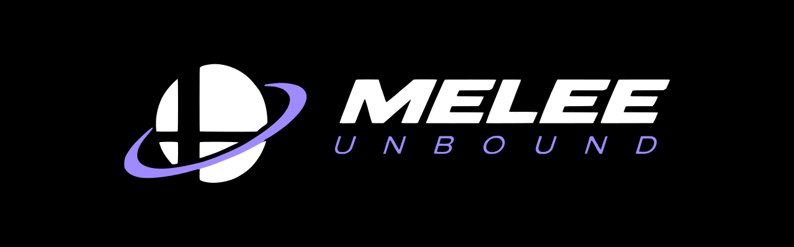

<p align="center">
  <a href="https://melee.hexdump0.pw">
    
  </a>
</p>

<h1 align="center">Melee Unbound</h1>

<p align="center">
  <a href="https://melee.hexdump0.pw/play"></a>
  
  <a href="https://discord.gg/87kwPPetPD"></a>
</p>

A native port of **Super Smash Bros. Melee** (v1.02 / Rev 2) that
compiles the game's own decompiled source natively and adds several quality of life features

> Bugs and crashes might be present. This project is under active development and is not fully stable yet.

## Features

- Built directly from
  [`doldecomp/melee`](https://github.com/doldecomp/melee)
- A custom GX high-level emulator translates display lists to
  OpenGL/GLES 3, including TEV combiner shaders, texture decode and the
  asset converter
- AX is emulated on the host with a software mixer for the game's
  voices, sequences and ADPCM banks..
- WebAssembly mods that run under WAMR through a small host ABI (The QoL features are a mod too)
- Compiles to wasm32 (Emscripten, SDL3, WebGL2, JSPI).
- A Tauri app for settings, mods and crash reports etc

## Try it

**In a browser**: <https://melee.hexdump0.pw/play>: 

**Prebuilt releases**: [Releases](https://github.com/HexDump0/melee/releases)

## Build

**Requirements**: a 32-bit toolchain
(`gcc-multilib`), CMake, Ninja, SDL3 (`lib32-sdl3`), and Mesa with 32-bit
EGL/GLESv2

```sh
git clone --recurse-submodules https://github.com/HexDump0/melee
cd melee
./scripts/apply_decomp_patches.sh
cmake -S native -B build/native -DCMAKE_BUILD_TYPE=RelWithDebInfo
cmake --build build/native -j"$(nproc)"
ctest --test-dir build/native
```

For windows 

```sh
native/tools/windows_build.sh /tmp/melee-win /path/to/sdl3-prefix
```

For the browser build


```sh
source ~/projects/emsdk/emsdk_env.sh          # Emscripten 6.0.9
site/scripts/build-play.sh
```

## Running and testing

```sh
./build/native/melee                       # actual game
./build/native/melee --match               # debug match
./build/native/melee --match 600           # ...for 600 frames, then exit
```

Look at [`native/AI/TESTING.md`](native/AI/TESTING.md) for a list of all the configurable options 

## Mods

A mod is a directory in `mods/` with a `mod.toml` manifest and a WebAssembly
module

## Legal

A fan project. Not affiliated with or endorsed by Nintendo. No game assets are
distributed in this repository, and none ever will be: you need your own copy
of Melee v1.02 (`GALE01`) to build or run anything that loads data. The
decompilation in `decomp/` is [`doldecomp/melee`](https://github.com/doldecomp/melee)'s
work under its own terms; the port's own code in `native/`, `launcher/` and
`site/`